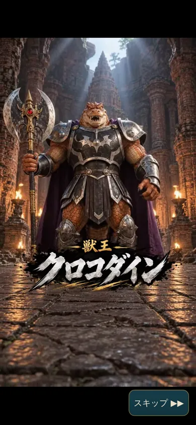
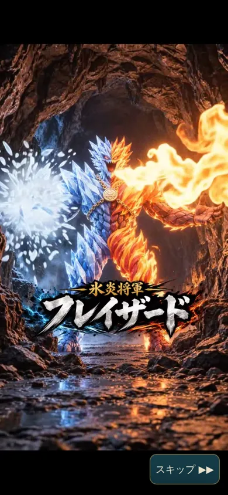
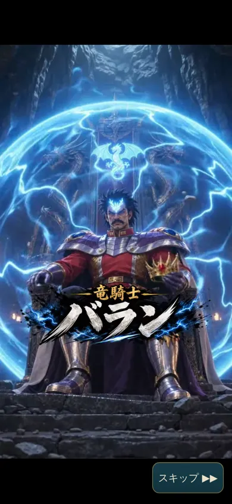
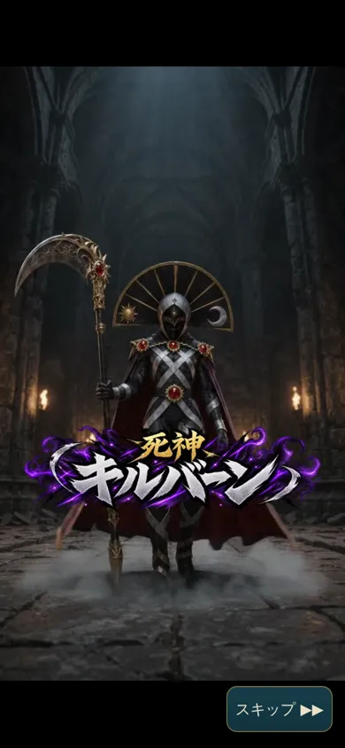
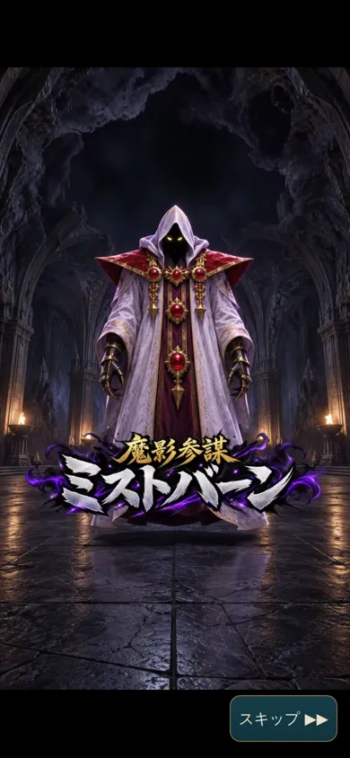
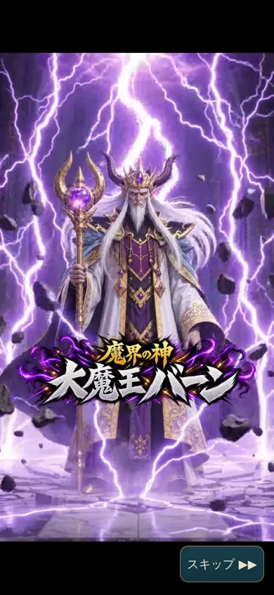

# ボスの登場ムービー（2026年10月）：クロコダイン

素材はZIP「take-sai-crocodine-movie-v1」です。指示書は `assets/reference/crocodine-movie-v1/CLAUDE_INSTRUCTIONS.md` に置いています。

## 動画の置き場所
| ファイル | 中身 |
|---|---|
| `assets/movies/crocodine-intro.mp4` | 720×1280、10秒、24fps、H.264＋AAC。再エンコードせず、そのまま置いています |
| `assets/movies/crocodine-poster.jpg` | 読み込み中に出す最初の1コマ |

- **パスの書き方:** `js/assets.js` の `movies.crocodine` に、相対パスで書いています。公開先がサブパス（`/take-sai-adventure/`）でも、そのまま取得できることを確かめました。
- **Git LFS:** 使っていません。動画そのものがリポジトリに入っています。
- **読み込むタイミング:** 起動時には読み込みません。クロコダインの階（15階）に着いたときに、動画の読み込みだけを始めます（`prepareBossIntro`）。

## 流れるとき（`js/game.js` の `checkBossRoom`・`G.finishBossIntro`）
- **流れる条件:** ボスID `croc` の部屋（`run.bossFight` の範囲）の中へ、初めて入ったとき。
  - どのボスで流すかは、`js/data.js` の `D.BOSS_INTROS = { croc: 'crocodine' }` で決めています。名前の文字ではなく、ボスIDで判定します。
  - 階段で15階に着いたとき、通路で待っているときは流れません。
- **ムービー中のゲーム（`run.bossFight.intro = 'pending'`）**
  - 戦いはまだ始まっていません。ボスは部屋の中央で待ったままで、HP・位置は変わりません。
  - 入室の1歩は、今までどおり1ターンです。
  - 方向ボタン・キー・タップは、すべて動画が受け止めます。ターン・敵は進みません。
  - 万一、ムービー中に行動が届いても、ムービーを終えた扱いにして戦いを始めます。その行動はせず、ターンも進めないので、固まりません。
- **終わり方（どれも同じ処理を1回だけ通ります）**
  - 最後まで見たとき、スキップしたとき、Escキー、読み込めなかったとき。
  - 終わると `intro = 'done'` になり、村の `story.introSeen.croc = true` を保存します。
  - そのあと、今までの戦闘開始（表示・ボスのHPバー・ボス戦の曲・戦いの前の会話）を1回だけ行います。
  - ムービーの終わり自体では、ターンは進みません。ボスは次のターンから動きます（入室のターンに動かないのは、今までと同じです）。
- **もう一度は流れないとき:** 再入室、同じ探索の中、次の探索。
- **以前のセーブ**
  - すでに戦い中・撃破済みなら流しません。HP・報酬・持ち物・資金はそのままです。
  - `story.introSeen` が無いセーブには、読み込むときに空の記録を足します。セーブの版は変えていません。
- **ムービー中に読み込み直したとき:** 「つづきから」で、ボス戦の状態はそのままで、ムービーを最初から流し直します（スキップできます）。
- **ほかのボス:** 階層・ほかのボスは変えていません。ムービーはクロコダインだけです。

## 画面と音（`js/ui.js` の `playBossIntro`、`css/style.css` の `.movie`）
- **画面**
  - ゲームの画面の一番手前に、黒い背景で動画を出します。`object-fit: contain` なので、縦の動画を切らずに全体を見せます（横向きの画面でも同じ）。
  - `playsinline` で、全画面にはしません。ループもしません。
  - スキップのボタンは右下に常に出ています。セーフエリアの内側にあり、大きさは120×52です。
- **自動再生が拒否されたとき:** 「▶ タップして再生」を出します。動画のどこをタップしても再生が始まります。勝手に消音にして、見た扱いにはしません。
- **読み込めない・時間がかかるとき**
  - 読み込めない（404・再生できない形式）：「ムービーを読み込めませんでした。戦いを始めます。」と出し、約1.2秒で戦いへ進みます。
  - 読み込みが6秒以上止まる：案内と「↻ 再試行」を出します。スキップはいつでもできます。決まった時間で打ち切るタイマーはありません。
- **アプリを裏にしたとき:** 一時停止します（戦いも進みません）。戻ると「▶ タップして再開」を出します。
- **音**
  - ムービー中は探索の曲を止めます。終わるとボス戦の曲になります。
  - 音オフなら消音のまま流します。音量はBGMの音量に合わせます。
  - 終わったら動画を止めて外すので、音が残ったり二重に鳴ったりしません。

## 確認したこと（PCのブラウザで、スマホの幅を再現）
このPCの Chromium は H.264 を再生できません。そのため、同じ動画を VP9（webm）にしたものを差し替えて流しました。差し替え用の動画はリポジトリに入れていません。確認の道具は `tools/movie-check.js` です。

- **最初の入室（幅360・390・430）**：33項目すべて通りました。
  - 階段で着いただけ・通路で待つだけでは流れません。入室で流れます。
  - 動画の枠は画面いっぱいで、`contain` です。スキップは画面の中にあり、大きく押しやすいです。
  - ムービー中はキー・方向ボタンを押しても、ターン・たけ・ボス（位置・HP）が変わりません。
  - 最後まで見ると、戦いが1回だけ始まり、ボス戦の曲になり、保存されます。そのあと操作が戻ります。
  - 再入室・次の探索では流れません。エラーもありませんでした。
- **いろいろな場合**：19項目すべて通りました。
  - スキップの連打：1回だけ開始し、video要素も残りません。
  - 終わる直前のスキップ、Escキー。
  - 自動再生の拒否：「タップして再生」が出て、タップで再生できます。
  - 音オフ：消音で流れます。
  - 404、再生できない形式（元のmp4をそのまま渡した場合）：どちらも固まらずに戦いへ進みます。
  - 遅い回線：待っている間も止まったままで、案内が出て、スキップできます。
  - 裏に回す・戻す：一時停止し、「タップして再開」から再開できます。
  - ムービー中の読み込み直し：最初から流し直し、スキップで戦いへ進みます。
  - 以前の戦い中のセーブ：流れず、HPもそのままです。
  - 見たことがあるセーブ：入室ですぐ戦いが始まります。
- **横向き（844×390）:** 縦の動画の全体が見えました。
- **自動テスト:** ロジック138件、ブラウザ54件がすべて通りました。
  - 足したテスト：ムービーのロジックのテスト、動画と最初の1コマがサブパスで取得できるかのテスト。
  - 直したテスト：第1章と音楽のテストは、ムービーをスキップしてから進むようにしました。
- **画面の記録:** `docs/crocodine-movie-v1/` に置いています（再生中、タップして再生、戦闘開始後、横向き）。

## まだ確かめていないこと
- 実際のスマホ（Android・iPhone）での再生。H.264 の映像と、AAC の音が鳴るか。
- 実際のスマホで、音付きの自動再生が許されるか拒否されるか。入室の1歩のタップのあとに再生するので、多くの場合は許されるはずです。
- 本物の遅い回線での、読み込みの待ち時間。
- 音を耳で聞いての確認（動画の音と曲が重ならないか、音量）。

# バランの登場ムービー（2026年10月）

- **素材**：採用済みの完成動画を、そのまま `assets/movies/baran-intro.mp4` に置きました（720×1280、10秒、H.264＋AAC。faststart 済みで、再エンコードしていません）。
  - 最初の1コマを、読み込み中の絵 `baran-poster.jpg` にしました。
- **対象**：第4章・地下30階、玉座のバラン（ボスID `baran`）だけです（`D.BOSS_INTROS = { croc, baran }`）。
  - 地下40階の裏ボス「竜人王バラン」は、まだゲームにありません。作るときは別のボスIDにするので、この動画は流れません。
- **流れ**：クロコダインと同じ仕組み（`checkBossRoom`・`G.finishBossIntro`・`playBossIntro`）です。
  - ボス部屋の中へ初めて入った瞬間に流れます。階段で30階に着いたとき・通路にいるときは流れません。
  - 動画中は操作・敵・ターンが止まり、探索の曲も止まります。
  - 終わる・スキップ・読み込めない・再生エラーのどれでも、同じ処理を1回だけ通って戦闘開始・ボス戦の曲になります。
  - 入室の1歩のほかにターンは進まないので、敵が余分に動くことはありません。
  - 報酬・撃破の記録は付けません。見た記録は `story.introSeen.baran` に残り、同じ戦闘での出入りや、次の探索では流れません。
- **確認したこと**：
  - ブラウザでの確認：`tools/movie-check.js` をバラン用にしたもので、52項目すべて通りました（幅360・390・430の最初の入室、スキップ連打、終わる直前のスキップ、Escキー、自動再生の拒否、音オフ、404、再生できない形式、遅い回線、裏に回す、ムービー中の読み込み直し、戦い中の旧セーブ、見たことがあるセーブ）。
  - 自動テスト：ロジック144件（バランのテストを追加）・ブラウザ54件が、すべて通りました。
  - 画面の記録：`docs/baran-movie-v1/`。
- **まだ確かめていないこと**：実際のスマホでの再生と音。

---

# 撃破後ムービー（2026年10月）：通常のバラン「ミストバーンが連れ去る」

登場ムービーとは別の「撃破後ムービー」です。受け取った完成動画を、再エンコードせずにそのまま置いています。

| ファイル | 中身 |
|---|---|
| `assets/movies/baran-taken.mp4` | 720×1280、10秒、24fps、H.264＋AAC。再エンコードなし。先頭に再生用の情報（moov）があるので、読み込みながら再生できます |
| `assets/movies/baran-taken-poster.jpg` | 読み込み中に出す最初の1コマ |

- 名前は `js/assets.js` の `movies.baranTaken`。どのボスで流すかは `js/data.js` の `D.BOSS_OUTROS = { baran: 'baranTaken' }`（ボスID）。
- **流れる条件:** 章の探索で通常のバラン（ID `baran`）を倒したとき。クリア後の竜人王バランは別のIDにする予定なので、流れません。ほかのボス・以前の版の探索（legacy）でも流れません。
- **流れ:** 撃破 → いつもの撃破の演出（画面の光・「バランを倒した！」）→ 約1.1秒後にムービー → いつもの撃破後の会話（「……その剣に、ヤナイの教えを見た。」）→ 操作が戻る。

## ゲーム側（`js/game.js`）
- 報酬（真魔剛竜剣）、撃破の記録、帰還口は、撃破のときに1回だけ処理します。ムービーでは何も増えません。
- バランは撃破のときに部屋から消え、戻りません。ムービーの中のミストバーンとは戦いません。
- 撃破のときに `run.postMovie = 'baranTaken'` を付けて保存します。付いている間は行動を受けつけません。
  - 万一、行動が届いても、行動はせず、ターンも進めず、ムービーを終えた扱いにします。固まりません。
- `G.finishPostMovie(S)` で外します。何度呼んでも1回だけです。

## 画面側（`js/ui.js` の `playPostMovie`）
- 今の再生の仕組み（`playStoryMovie` → `movieOverlay`）とスキップを使います。縦横比はそのまま（`contain`）で、人物は切れません。
- **止めるもの**
  - 撃破の演出からムービーが終わるまで、方向ボタン（長押し・ダッシュを含む）、キー、向きの変更を受けつけません。ターンも敵も進みません。
  - ゲームの曲は撃破のときから止め、動画の音を流します（音オフなら消音）。
- **終わり方:** 最後まで見た・スキップ（連打しても1回）・Escキー・読み込み失敗（「ムービーを読み込めませんでした。続きへ進みます。」）のどれでも同じです。
  - `postMovie` を外して保存し、探索の曲に戻して、撃破後の会話へ進みます。
- **途中で読み込み直したとき:** 「つづきから」で最初から流し直し（スキップできます）、そのあと会話へ進みます。報酬は増えません。
- **二重には流しません:** 1回の撃破につき1回だけです。

## 確認（PCのブラウザで、スマホの幅を再現。`tools/baran-outro-check.js`、43項目すべて通りました）
このPCの Chromium は H.264 を再生できないので、同じ動画を VP9（webm）にしたものに差し替えて流しました。差し替え用の動画はリポジトリに入れていません。

- **幅360・390・430で、最後まで見たとき**
  - 撃破のときに報酬2つ・帰還口・撃破1回が済み、ムービーの予約も保存されます。まず撃破の演出が出ます。
  - 演出からムービーまでの間、およびムービー中は、キー・方向ボタン（長押しを含む）でターンも位置も変わりません。
  - 動画は画面いっぱいの枠に `contain` で出ます。動画の音が鳴り、ゲームの曲は止まります。
  - 終わると会話へ進み、操作と探索の曲が戻ります（1歩でターンが1つ進む）。バランは戻りません。エラーもありません。
- **スキップの連打、読み込み失敗（404）、途中の読み込み直し:** どれも会話へ進み、報酬は増えません。
- **クロコダイン:** 撃破後ムービーは流れません。
- **今までのテスト:** 登場ムービーの確認（クロコダイン52項目・バラン52項目）、ロジック153件、ブラウザ54件がすべて通りました。
- **画面の記録:** `docs/baran-taken-v1/`（撃破の演出、再生中、会話）。

## まだ確かめていないこと
- 実際のスマホでの H.264 と AAC の再生。
- 実際のスマホで、音付きの自動再生が許されるか（拒否されたときは「▶ タップして再生」が出ます）。

---

# 撃破後ムービー（2026年10月）：大魔王バーン（30階）「ミストバーンが時の裂け目へ連れ去る」

受け取った完成動画を、再エンコードせずにそのまま置いています。大魔王バーンの登場ムービー（`vearn-intro-titled.mp4`）は変えていません。

| ファイル | 中身 |
|---|---|
| `assets/movies/vearn-taken.mp4` | 720×1280、10秒、24fps、H.264＋AAC。再エンコードなし。先頭に再生用の情報（moov）があるので、読み込みながら再生できます |
| `assets/movies/vearn-taken-poster.jpg` | 読み込み中に出す1コマ（0.5秒の位置） |

- 名前は `js/assets.js` の `movies.vearnTaken` です。これまで「（ムービー準備中）」の仮の会話を出していた場面が、この動画になりました。
- **仕組み:** 通常のバランと同じ `run.postMovie` を使います（`js/game.js` の大魔王バーン（版3）の撃破のところで `run.postMovie = 'vearnTaken'`）。
- **流れ:**
  1. HP0。
  2. いつもの撃破の演出（画面の光・「大魔王バーンを倒した！」）。
  3. 約1.1秒後にムービー（1回だけ）。
  4. 同じ30階のボス部屋に戻ります。たけの位置もそのままです。
  5. バーンはいません。
  6. ティウの救援の画面へ進み、救援を終えると操作が戻ります。
- **村へは戻しません。** 帰還口も出ません。玉座の後ろの下り階段と、ローブ（初回だけ、撃破のときに1つ）は、これまでどおりです。
- **止めるもの:** 撃破の演出からムービーが終わるまで、方向ボタン（長押し・ダッシュを含む）、キー、向きの変更を受けつけません。ターンも進みません。ゲームの曲は止め、動画の音を流します。
- **終わり方:** 最後まで見た・スキップ（連打しても1回）・読み込み失敗のどれでも、同じ部屋に戻って救援の画面へ進みます。
- **途中で読み込み直したとき:** 「つづきから」でムービーを最初から流し直し、そのあと救援へ進みます。
  - ムービーのあと（救援の画面）で読み込み直したときは、ムービーは流さずに救援の画面だけ開き直します。
- **動画の中の「時の裂け目」:** ムービーのあと、同じ部屋（玉座の右手前）に時空の亀裂が残ります（`docs/THRONE_ROOM.md`）。玉座の後ろの下り階段はやめました。

## 確認（PCのブラウザで、スマホの幅を再現。`tools/vearn-outro-check.js`、54項目すべて通りました）
Chromium は H.264 を再生できないので、同じ動画を VP9（webm）にしたものに差し替えて流しました。

- **幅360・390・430で、最後まで見たとき**
  - HP0で、まず撃破の演出が出ます。ムービーの予約は保存済みです。
  - 演出からムービーまでの間と、ムービー中は、キー・方向ボタン（長押しを含む）でターンも位置も変わりません。
  - 動画は `contain` で画面に収まり、動画の音が鳴ります。
  - 終わると、同じ30階の同じ位置で救援の画面が開きます。バーンはいません。ローブは1つだけで、ムービーは1回だけ流れます。エラーもありません。
  - 登場ムービー（`vearn`）は残っています。
- **スキップの連打、読み込み失敗（404）、途中の読み込み直し、救援の画面での読み込み直し:** どれも同じ部屋の救援の画面へ進み、二重には流れません。
- **今までのテスト:** ロジック169件、ブラウザ54件、最終章の画面の確認（`tools/final-v3-check.js`）24項目がすべて通りました。
- **画面の記録:** `docs/vearn-taken-v1/`（撃破の演出、再生中、救援の画面）。

## まだ確かめていないこと
- 実際のスマホでの再生と音（耳での確認）。

## 決まったこと（2026年10月）
- 30階の亀裂は、真大魔王バーンを倒す前は31階へ、倒したあとは隠しダンジョンの入口（`docs/FINAL_V3_SETS.md`）。

---

# 登場ムービーを「名前テロップ入り完成版」に差し替え（2026年10月）

| ボス | 前 | 今 |
|---|---|---|
| 獣王クロコダイン（第1章・15階） | `crocodine-intro.mp4` | `assets/movies/crocodine-intro-titled.mp4`（最初の1コマ `crocodine-titled-poster.jpg`） |
| 氷炎将軍フレイザード（第2章・20階） | **登場ムービーは無かった** | `assets/movies/flazzard-intro-titled.mp4`（`flazzard-titled-poster.jpg`）。`D.BOSS_INTROS.flame = 'flazzard'` を追加 |
| 竜騎士バラン（第4章・30階） | `baran-intro.mp4` | `assets/movies/baran-intro-titled.mp4`（`baran-titled-poster.jpg`） |

- **動画:** 3本とも 720×1280、10秒、24fps、H.264＋AAC です。再エンコードせず、そのまま置いています。
  - 先頭に再生用の情報（moov）があるので、読み込みながら再生できます。
- **キャッシュ対策:** 古い動画がキャッシュで流れないよう、ファイル名を変えました。古い動画と最初の1コマはリポジトリから消しています。
- **テロップ:** 映像に焼き込み済みです。ムービーの上に名前は重ねていません（もともと動画の上に出すのは「スキップ」だけです）。
  - 戦いが始まったときの「○○との戦いが始まった！」の知らせは、ムービーが終わってから、ゲームの画面に出ます。
- **変えていないこと:** 再生の時期（ボス部屋に初めて入ったとき）、スキップ、操作の停止、曲の止め方、終わったあとの戦いの始まり方。
  - フレイザードも、クロコダイン・バランと同じ流れになりました。
- **ほかに再生する場所:** 図書館などでムービーを見直す機能は今のゲームに無いので、差し替え先はここだけです。
- **バラン撃破後のムービー:** ミストバーンが連れ去る `baran-taken.mp4` は差し替えていません。

## 確認（PCのブラウザ。H.264 が再生できないので、同じ動画を VP9 にした webm に差し替えて流しました）
- **`tools/intro-titled-check.js`（67項目）:** 3体それぞれで確かめました。
  - 正しい動画が流れること。
  - 幅360・390・430で、縦横比を保って全体が画面に収まること（テロップの左右が切れない）。
  - 動画の上に名前の表示が無いこと。
  - 再生中はゲームの曲が止まり、動画の音が鳴ること。
  - 最後まで・スキップ・読み込み失敗のどれでも、戦いが1回だけ始まり、ボス戦の曲になり、操作が戻ること。
  - 古いファイルと参照が残っていないこと。
- **`tools/movie-check.js`:** クロコダインの以前からの確認52項目が、新しい動画で通りました。
- **自動テスト:** ロジック161件、ブラウザ54件がすべて通りました（3本ともサブパスで取得できるテストを含む）。
- **実際のスマホ:** H.264・AAC の再生、音つき自動再生が許されるかは、まだ確かめていません。

  

## 死神キルバーンの登場ムービーを追加（2026年10月）
- **動画:** `assets/movies/killvearn-intro-titled.mp4`（720×1280、10秒、24fps、H.264＋AAC、再エンコードなし）と、最初の1コマ `killvearn-titled-poster.jpg`。
- **仕組み:** 今までキルバーンの登場ムービーはありませんでした。ほかのボスと同じ表に `D.BOSS_INTROS.kill = 'killvearn'` を足しました。
- **再生の時期:** 第3章25階のキルバーンの部屋に初めて入ったとき、戦いの前に1回だけ流れます。
  - 流れている間は、操作もキルバーンも止まります。ムービー中に攻撃を受けることはありません。
  - 最後まで・スキップ・読み込み失敗のどれでも、戦いは1回だけ始まり、ボス戦の曲になります。
  - 一度見たら、同じ探索でも次の探索でも、もう流れません。
- **テロップ:** 映像に焼き込み済みです。ゲーム側で名前は重ねていません。
- **変えていないこと:** ほかのボスの動画・能力・報酬・物語。
- **ムービー集:** 図書館などのムービー集は今のゲームに無いので、登録する所はありません。
- **確認:** `tools/intro-titled-check.js` を4体に広げ、89項目すべて通りました。
  - キルバーンは幅360・390・430で、動画全体とテロップが欠けずに収まりました。
  - ロジックのテストに、キルバーンの登場（ムービー中は行動せず、ダメージも無く、戦いの開始は1回）を足しました。
  - ブラウザのテストでは、4本ともサブパスで取得できることを確かめました。

## 魔影参謀ミストバーンの登場ムービーを追加（2026年10月）
- **動画:** `assets/movies/mistvearn-intro-titled.mp4`（720×1280、10秒、H.264＋AAC、再エンコードなし）と、最初の1コマ `mistvearn-titled-poster.jpg`。
- **仕組み:** `D.BOSS_INTROS.mist = 'mistvearn'` を足しました。キルバーンたちと同じ流れです。
  - 第5章30階のミストバーンの部屋に初めて入ったとき、戦いの前に1回だけ流れます。
  - スキップ・読み込み失敗でも、戦いは1回だけ始まります。
- **テロップ:** 映像に焼き込み済みなので、ゲーム側では重ねていません。
- **確認:** `tools/intro-titled-check.js` を5体に広げ、111項目すべて通りました（ミストバーン22項目）。
  - ロジック163件、ブラウザ54件もすべて通りました。

## 魔界の神 大魔王バーンの登場ムービーを追加（2026年10月）
- **動画:** `assets/movies/vearn-intro-titled.mp4`（720×1280、10秒、H.264＋AAC、再エンコードなし）と、最初の1コマ `vearn-titled-poster.jpg`。
- **仕組み:** `D.BOSS_INTROS.vearn = 'vearn'` を足しました。ほかのボスと同じ流れです。
  - 最終章30階の大魔王バーンの部屋に初めて入ったとき、戦いの前に1回だけ流れます。
  - スキップ・読み込み失敗でも、戦いは1回だけ始まります。
  - 撃破後の「ミストバーンが連れ去る」場面・救援・35階の流れは変えていません。
  - 遊んでいる途中の古い版（35階で連戦）の挑戦では、35階の大魔王バーンの入室で流れます。
- **テロップ:** 映像に焼き込み済みなので、ゲーム側では重ねていません。
- **確認:** `tools/intro-titled-check.js` を6体に広げ、133項目すべて通りました（大魔王バーン22項目）。
  - ロジック163件、ブラウザ54件、`tools/final-v3-check.js` 24項目もすべて通りました。
  - 最終章の流れのテストは、登場ムービーのあとに戦いが始まる形に合わせました。

---

# ムービーの前後の暗転（2026年10月）

ボスの登場ムービー・撃破後ムービーなど、動画を流す共通の処理（`js/ui.js` の `movieOverlay`）に入れました。動画ファイルは加工していません。

| 場面 | 長さ（`UI.MOVIE_FADE`） | 中身 |
|---|---|---|
| 入り：暗転 | `out` 0.5秒 | ゲーム画面を黒へ。BGMも同じ長さで下げる |
| 入り：用意 | 最大 `ready` 0.7秒 | 黒のまま、動画の最初のコマを用意する |
| 入り：動画を明るく | `in` 0.4秒 | 最初のコマを明るくしてから再生を始める（冒頭を見逃さない） |
| 終わり：最後まで見た | `endOut` 0.4秒 | 最後のコマのまま黒へ（動画の音も下げる） |
| 終わり：スキップ | `skipOut` 0.25秒 | 短い暗転 |
| 終わり：読み込み失敗 | `errOut` 0.2秒 | 黒い画面で案内（約1.2秒）のあと、今までの代わりの流れへ |
| 戻り：ゲーム画面を明るく | `reveal` 0.5秒 | 場面の曲も同じころに上げる。明るくなりきってから操作を戻す |

- 黒い幕（`.movie` の背景）は最後まで残します。
  - 読み込み中に、元のゲーム画面や白い画面が見えません。
  - 動画が終わった直後に、ゲーム画面が先に見えることもありません。
- ムービー後の状態は、黒の間に用意します（戦闘開始・撃破後の会話・救援の画面・亀裂・曲）。
  - 報酬・イベント・戦闘開始は、今までどおり1回だけです。
- **入力:** 暗転の始めから明るくなりきるまで受けつけません。
  - 幕がタップを受け止め、`UI.modals` と `UI.lockUntil` で止めています。
  - 連打しても、移動・攻撃・動画の多重起動は起きません。
- **最初のコマの用意が遅いとき（iOS など、再生を始めるまで読み込まない端末）:** 黒のまま再生を始め、映った時点で明るくします。
- **音:** ゲームのBGMは暗転に合わせて下げます（`AU.holdBgm(true, 0.5)`）。動画の音とは重なりません。
  - 終わったら、その場面の曲を0から上げてつなぎます（`AU.fadeInBgm`）。
- 動画が無く仮の会話を出す場面（`movieFallback`）は、今までどおりです（暗転なし）。

## 確認（`tools/movie-fade-check.js`、幅360・390・430）

ページの中で、毎コマ「幕の濃さ・動画の濃さ・再生位置」を記録して確かめました（86項目）。

- **入り**
  - 幕が黒くなりきってから動画が見え始めます（暗転 約0.38〜0.5秒）。
  - 黒い間は再生が進みません。見え始めたときの再生位置は0秒です。
  - 動画のフェードインは約0.3〜0.4秒です。
- **終わり**
  - 動画が先に暗くなり（約0.35秒）、そのあと幕が薄くなります（約0.47秒）。
  - その間、ゲーム画面は見えません。
- **スキップ**
  - 短い暗転（約0.23秒）です。連打しても1回だけで、ターンは進みません。
- **読み込み失敗**
  - 黒いまま止まらず、戦いが1回だけ始まります。
- **登場・撃破後のあと**
  - 戦いは1回だけ始まり、ボス戦の曲に戻ります。
  - 撃破後は、同じ部屋に亀裂・ローブ1つ・救援が出ます。
- **画面録画:** `docs/movie-fade-v1/`（幅390）
  - 登場ムービーに入るところ・戻るところ
  - 撃破後ムービーに入るところ・戻るところ
  - スキップ
- Chromium は H.264 を流せないので、同じ動画の VP9 版に差し替えて録っています。

## まだ確かめていないこと
- 実際のスマホでの見え方と間合い。
- iOS で、暗転のあとの音つき再生が許されるか。拒否されたときは「▶ タップして再生」が出ます。
