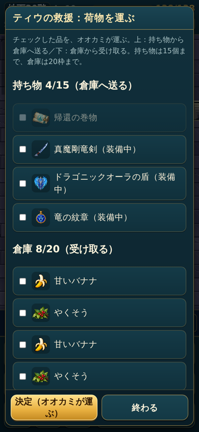
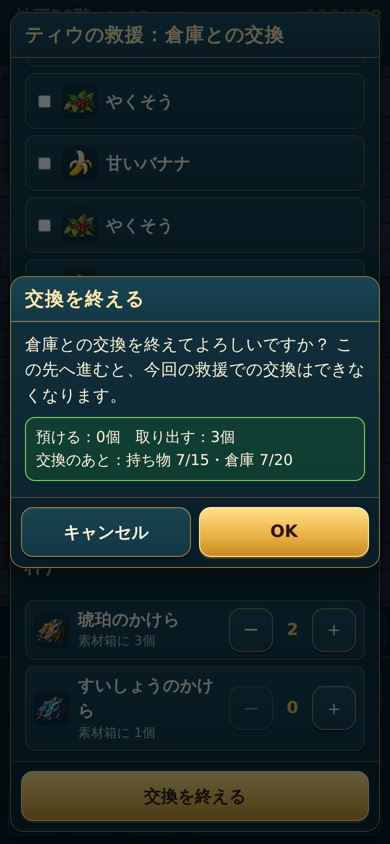
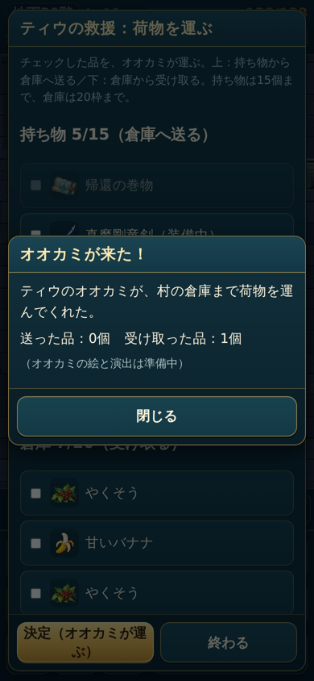
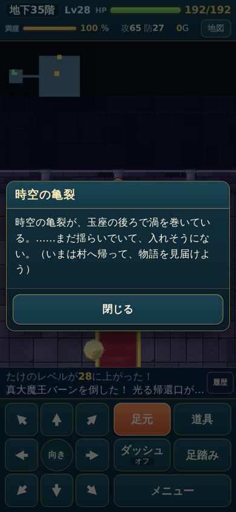

# 最終章（版3・版4）・竜の装備セット・ティウの救援

ChatGPT の「最新の回答・実装指示」（1〜14）のうち、**確定した部分だけ**を実装した記録。保留の項目は、勝手に決めずに仮の扱いにしている（下の「保留・仮の扱い」）。

## 最終章の流れ（版4、`D.LAYOUT = 4`。2026年10月）

### 本編（初回）
| 階 | できごと |
|---|---|
| 30階 | 大魔王バーンの玉座の間（下の通路から上へ入る。`docs/THRONE_ROOM.md`）。撃破 → 撃破の演出 → ミストバーンが連れ去るムービー（`vearnTaken`）→ 同じ部屋に**時空の亀裂**が残る → ローブ（初回のみ）→ ティウの救援（回復・倉庫との交換）→ 亀裂から31階へ。**村への帰還口・下り階段は出ない** |
| 31〜32階 | 普通に探索（自動で飛ばさない） |
| 33階 | 32階から降りた直後に覚醒ムービー（`trueVearnAwaken`、白い異空間で老バーンとミストバーンが融合）→ サイたちの祈り → 白い異空間で真大魔王バーン → 帰還口とエンディング。亀裂は出ない（[TRUEVEARN_AWAKEN.md](TRUEVEARN_AWAKEN.md)） |

### 30階の時空の亀裂（行き先は進行で切り替わる。確定）
`G.crackState` で決めます。亀裂は大魔王バーンを倒したときに決めて保存し（`run.crack`、`kind: 'throne30'`）、撃破後ムービーの間は画面に出しません。
- `rescue`：ティウの救援が終わるまで。入れません。
- `next`：真大魔王バーンを倒す前。地下31階へ進みます。
- `hidden`：真大魔王バーンを倒したあと。隠しダンジョン「時空の狭間」の31階へ進みます（`run.hidden`）。
- `hiddenNotReady`：`D.HIDDEN_DUNGEON` が無いときだけ（今は使いません）。

### 隠しダンジョン「時空の狭間」（2026年10月確定。`D.HIDDEN_DUNGEON`）
| 階 | 中身 |
|---|---|
| 31階 | 30階の亀裂から入る最初の階。部屋の数が本編の約2倍。敵は大魔王の城と同じ |
| 32〜34階 | 部屋の数が約2倍。**強敵（仮）**：今の敵をHP・攻撃1.35倍、経験値1.6倍にしただけ。入ると「強敵の気配がする……」 |
| 35階 | 最奥。**竜人王バラン**（`dragonbaran`）。ボス部屋は本編と同じ（前室5×5・大広間15×15。部屋の数の倍率は使わない） |

- **部屋の数（2026年10月修正。前の「部屋の面積2倍」は取りやめ）**
  - 部屋の大きさと通路の幅は本編と同じで、部屋の数を約2倍にしています（`D.HIDDEN_MAP`）。

    | | 区画 | 通路の分かれ道 | 部屋の数（60通りの平均） | 地図 |
    |---|---|---|---|---|
    | 本編 | 3×3 | 0〜3 | 7.5 | 33×24マス |
    | 隠しダンジョン | 4×4 | 0〜2 | 15.0 | 44×32マス |

  - 1000通りの地図で、部屋は最少14、入口から階段へ必ず行けることを確かめました。地図を作る時間は1階0.5ミリ秒ほどです。
  - 長すぎる・重いときの調整案：4×3区画・分かれ道0〜1（部屋11〜12、約1.5倍）。
- **配置数（仮・調整案）**

  | | 道具 | お金 | 敵 |
  |---|---|---|---|
  | 本編の魔王の城（31階） | 5〜7（平均6.5） | 3〜4（平均3.6） | 6〜7（平均7.5） |
  | 隠しダンジョン | 10〜14（平均11.9） | 6〜8（平均7.2） | 9〜11（平均10.3） |

  - 道具とお金は約2倍、敵は約1.5倍（部屋が倍になった分、敵の密度は少し下がる）です。
  - 平均にはモンスターハウスの分も入っています。
- **帰還の祠:** ありません。帰るには、帰還の巻物を使うか、竜人王バランを倒したあとの帰還口を使います。
- **本編との違い:** 本編の31〜33階とは別の階です。読み込み直しても隠しダンジョンのままです。
- **強敵（32〜34階）:** 専用の強敵6種を置きます。以前の「今の敵を一律1.35倍」はやめました（詳しくは下）。

#### 隠しダンジョンの強敵6種（2026年10月：動きは確定。数値はすべて**仮**＝`D.STRONG` と敵の定義）
| 敵 | 動き（確定） | 仮の数値 |
|---|---|---|
| ドラゴン | たけが一直線上（2〜射程マス）で、間に壁が無ければ炎を吐く。炎は壁か**最初に当たったキャラクター**で止まり、貫かない。間の敵に当たればその敵だけにダメージ（後ろのたけには当たらない。その敵が倒れても炎は先へ進まない）。炎の絵も止まった所まで。隣なら通常攻撃 | HP190・攻46・防20・経験230。射程5・威力 攻撃×1.3・使ったあと3ターン待つ |
| シルバーデビル | 1手番に2回動く：離れていれば2歩、隣なら2回攻撃、1歩目で隣になれば残り1回で攻撃（2歩のあとに攻撃はしない）。たけの3点セットの2回行動とは別の仕組み | HP110・攻34・防16・経験200 |
| ギガンテス | ひたすら近づいて通常攻撃。特別な技なし | HP320・攻58・防26・経験300 |
| 爆弾岩 | HPが最大の20%以下で移動しない（隣なら攻撃はする）。0より大きく10%以下になったら即自爆。一撃で0以下なら自爆せずに倒れる（倒れたかの判定が先） | HP150・攻30・防30・経験160。爆発：まわり1マス・攻撃×2.5。**仮**：まわりの敵・道具には影響なし、自爆では経験値なし |
| ミミック | 床のお宝（宝箱）に化けている。動かない。たけが隣に来た手番に正体を現して、その手番の攻撃を1回だけ（変身による追加の先制なし）。攻撃されても正体を現す。化けている間は「見えている敵」に入れない | HP160・攻48・防22・経験250。1階に1〜2体 |
| マドハンド | 攻撃が当たるとつかむ：移動できない（攻撃・道具・装備はできる）。つかんだマドハンドを倒すとすぐ解ける。3点セット（真魔剛竜剣・ドラゴニックオーラの盾・竜の紋章）を装備中は無効 | HP70・攻26・防12・経験90。自然に解けるまで3ターン |

- 32〜34階の出現の重み（仮）：ドラゴン2・シルバーデビル2・ギガンテス2・爆弾岩2・マドハンド3・魔王軍の騎士1・魔界の小鬼1。ミミックは別に1〜2体。
- 深い階ほど少し強くなる仕組み（ほかの敵と同じ。31階から）はそのままです。
- **見た目（2026年10月、ChatGPT制作の絵。描き直しなし）:** `assets/enemies/<名前>.png`（元は `assets/reference/strong-enemies-v1/`、`tools/make-strong-enemies.py`）。
  - 透明な余白を切り、縦横比を保って縮小しています。透過はそのままで、背景に黒い四角は出ません。
  - 敵の絵の枠（64×64・足の裏 y=60・中央 x=32）の3倍の細かさ（192×192）で持ち、画面では枠の大きさで描きます（`enemyArtScale`）。
  - 足元はマスの下端・中央にそろえます。占有マス・攻撃範囲は1マスのままです。
  - 枠の中の大きさ（1マス＝32）

    | 敵 | 幅×高さ |
    |---|---|
    | ドラゴン | 43×46 |
    | シルバーデビル | 42×42 |
    | ギガンテス | 41×48 |
    | 爆弾岩 | 34×34 |
    | ミミック | 37×36 |
    | マドハンド | 40×36 |

    幅は約1.3マスまでなので、隣のマスの敵や道具は見えたままです。
  - 各1枚の静止画です（歩きのコマは無い）。
  - ミミックの絵は正体を現した姿です。化けている間は床の宝箱の絵のままです。
  - 爆弾岩は通常の絵だけです。HPによる停止・自爆は戦いの仕様のとおりです。
  - 絵を読み込めないときだけ、今までの仮の見た目（今の敵の絵に色を重ねたもの、`SP.PLACEHOLDER`）になります。
- ドラゴンの炎で倒れた敵の経験値は、たけに入ります（今の仕組みのまま。決まっていなければ調整します）。
- 確認：`tools/strong-enemies-check.js`（幅360・390・430、390は録画 `docs/strong-enemies-v1/`）、`tests/logic.test.js`

#### 竜人王バラン（技の種類は確定。数値は調整案＝仮、`D.DRAGON_KING`）
| 技 | いつ | 範囲 | 威力（攻撃力×） | 待ち（前半/後半） | 隙 | よけ方 |
|---|---|---|---|---|---|---|
| 通常攻撃 | 隣で、ほかの技が待ち中 | 隣 | 1.0 | − | − | − |
| ドルオーラ | 一直線上で2マス以上 | 一直線（壁まで）。後半は縦横の十字 | 2.2 | 6/5 | 2ターン | 列（線）の外へ |
| なぎ払い | 隣 | まわり8マス | 1.6 | 4/3 | 1ターン | 1マス離れる |
| 突進 | 一直線上で3〜8マス | 一直線。たけか壁で止まる | 1.8 | 7/5 | 2ターン | 横へずれる |

- 能力：HP 1500・攻撃52・防御23（仮）。
- HPが半分以下でドラゴニックオーラが強まります。
  - 攻撃力が1.15倍になり、待ちが短くなり、ドルオーラが十字に変わります。
  - 予告と隙は後半も残します。
- 絵は通常のバランの絵を仮に使っています（専用の絵はChatGPT、登場ムービーは別のチャットで用意）。

#### 竜人王バランの報酬（`G.dragonKingRewards`）
- 真魔剛竜剣・ドラゴニックオーラの盾・アクセサリーの竜の紋章のうち、所有していない品だけ出します。
- **所有扱いにするもの**
  - 装備中・持ち物・倉庫・村のかばん。
  - 床に落ちたままの品（未回収。帰還時に倉庫へ届く品）。
  - 展示室。
  - 村の赤い橋の向こうでまだ拾っていない竜の紋章（あとで二重に手に入らないように）。
- **重ならないこと**：何度倒しても、持っている品は重ねて出しません。
- **専用強化素材**：撃破するたびに各1個出る仕組みにしています（`D.DRAGON_KING.materials`）。名前と種類数が決まるまでは空です。

- 確認：`tools/hidden-dungeon-check.js`（幅360・390・430）、`tests/logic.test.js`

### クリア後の再探索
- 30階・33階は、ボスがいなくても玉座の間の形のままです。
- 30階：大魔王バーンは出ません。亀裂は最初からあり、隠しダンジョンの入口です。ティウの救援もありません。
- 33階：真大魔王バーンは出ません。下への階段は無く、前室に帰還の祠があります。

### 以前の版の探索（更新前から続いているもの）
- 版3（`layout: 3`）：途中で階を変えません。30階・35階（31〜34階を探索）。35階の真大魔王バーンを倒すと、そこにも亀裂（以前の仕様の `none`／`unstable`／`notReady`／`open`）。
- 版2：以前どおり35階で連戦。

### 回復（30階の救援・33階の祈り）
- HPと満腹度を、それぞれ今の最大値まで回復します。毒と拘束は治ります。最大値そのものは増えません（`G.fullRecover`）。
- **救援:** `G.beginRescue` で1回だけです（`run.final.rescueHealed`）。画面を開き直したり、読み込み直したりしても重なりません。
- **祈り:** 戦いの開始と同じ1回だけです（`bossFight.engaged`）。登場の場面の途中で読み込み直しても重なりません。

## ティウの救援：倉庫との交換
1. **選ぶ**
   - 預ける：持ち物の品。装備中の品も預けられ、預けると外れます。能力とセットは計算し直します。
   - 取り出す：倉庫の品と、素材箱の素材（個数を ＋／− で選ぶ）。
   - 選んだ内容は**仮の交換予定**として `run.final.rescuePlan` に保存します。読み込み直しても残ります。
   - この段階では、品はまだ動きません。何度でも選び直せます。
2. **「交換を終える」**
   - 「倉庫との交換を終えてよろしいですか？ この先へ進むと、今回の救援での交換はできなくなります。」と確認します。
   - キャンセルなら選ぶ画面へ戻ります。
3. **OK（`G.commitRescue`）**
   - 持ち物15個・倉庫の枠を確かめ直してから、一括で交換し、救援を終えてすぐ保存します。
   - 容量をこえるときは何も動かさず、選ぶ画面へ戻ります（救援は続きます）。
   - 連打しても1回だけです。
4. **オオカミが届ける演出**
   - 今は文字だけの仮の表示です（`run.final.wolf`）。読み込み直したら演出だけ出し直し、交換は二重になりません。
   - 「進む」のあと、31階へ進めます。救援が終わるまでは、階段を降りられません。
- 確定したあとは、同じ挑戦の中ではもう交換できません。

### 素材の扱い
- 素材は、探索中は持ち物の1個1枠です。村では素材箱（`V.materials`、個数だけ）にあり、倉庫の枠は使いません。
- 救援でも、帰ったときと同じ扱いにしました。
  - 預けた素材は素材箱の個数に足します。
  - 取り出した素材は1個ずつ持ち物に入ります。
- 個数は変わらず、管理の仕方も変えていません。
- 送れないのは、倉庫に入れられない品（帰還の巻物・貸出品）だけです。

## 竜の装備

| 品 | 種類 | 入手 |
|---|---|---|
| 真魔剛竜剣 `shinma_sword` | 武器 | 通常のバラン（第4章の報酬） |
| （廃止）竜の紋章（お宝） `baran_emblem` | — | 2026年10月に廃止。竜の紋章は装飾品（`dragon_crest`）だけ。第4章の報酬は真魔剛竜剣だけ。以前のセーブの品は読み込みで消える（v9） |
| ドラゴニックオーラの盾 `dragonic_shield` | 盾 守り22（鍛冶で+8まで） | 竜人王バラン（未実装）の予定 |
| 竜の紋章 `dragon_crest` | 装飾品 攻撃+5 | 赤い橋の向こう岸で拾う（位置は仮） |

- 赤い橋は**通常のバランを倒したあと**に建てられる（900G のまま）。
- ティウのヒント：出発の画面の「ティウと話す」。橋ができる前から、紋章を拾うまで聞ける。橋を建てると仮の場面（`bridge`）。

### セット

| 組み合わせ | 効果 |
|---|---|
| 剣＋紋章 | 攻撃+5（装備だけで 24+5+5=34） |
| 剣＋盾 | 正面2マス目まで届く。手前の敵を貫通して2体まで。壁・角はこえない。戦いの前で待っているボス・商人には届かない。「バシュン！」（仮の文字の演出） |
| 紋章＋盾 | 守り+5 |
| 3点 | 上のすべて＋2回行動・飛んでいる見た目（仮：少し浮く）・ボスの床の印のダメージを受けない・新しい毒と拘束を受けない |
| 漆黒の盾＋大魔王のローブ | 満腹度が減らない。自然回復は2倍のまま（4倍にはならない）。攻撃は合計の0.8倍（**四捨五入**、`Math.round`）。真魔剛竜剣を**武器として装備しているときだけ**減らない（持ち物・倉庫にあるだけでは減る） |
| 大魔王のローブ | 自然回復2倍（毒・満腹度0のときは回復しない、今まで通り） |

### 紋章の身代わり

HPが0になると紋章が消えて、最大HPの50%で生き返る（`Math.max(1, Math.round(最大HP×0.5))`。3点セットなら全回復）。紋章が消えた時点でセットは計算し直し（2回行動・攻撃+5・守り+5 は消える）。

### 2回行動（3点セット）

- たけの2行動で、敵1回・時間（自然回復・満腹度・毒・敵の出現）1ターン。ターンを使わない操作（見る・メニューなど）は数えない。
- 判定は「その行動の**前**に3点セットだったか」。1回目のあとは `player.half = 1`。2回目のあと（または3点セットでない状態で行動したとき）に敵の手番と時間が進む。
- テストで確かめた行動順（1：1ターン進んだ、0：進まない、E：敵が動いた、h：1回目の途中）

| 行動 | 結果 |
|---|---|
| 待つ（セットなし） | 1E |
| 紋章を着ける（セットなしの行動） | 1E |
| 待つ（3点：1回目） | 0h |
| 待つ（2回目） | 1E |
| 紋章を外す（3点のまま1回目） | 0h |
| 待つ（もう3点ではない → 保留の1ターン） | 1E |
| 待つ | 1E |
| 紋章を着ける → 待つ（1回目）→ 紋章を外す（2回目） | 1E → 0h → 1E |
| すぐ着け直す（セットなしの行動） | 1E |

- 3点のまま10行動で、敵5回・5ターン。付け外しで行動は増えず、敵の手番も消えない。
- **紋章の身代わり:** 倒されるのは敵の手番の中（2回目のあと）なので、その手番は消えない。紋章が消えてセットが外れ、次の行動からは1行動＝1ターン（記録：「1回目：0h」「2回目（倒れて復活）：1」→ 次：1）。
- 1回目の行動のあとに階を移ると `half` は0に戻る（新しい階は数え直し）。

## ムービー

`playStoryMovie(名前, 次へ)`：動画（`TS.ASSETS.movies[名前]`）があれば動画、無ければ `D.STORY.movieFallback[名前]` の仮の会話（「（ムービー準備中）」つき）。最後まで見た・スキップ・読み込み失敗のどれでも「次へ」を1回だけ呼ぶ。見た記録は `story.moviesSeen`。報酬や進行はムービーの前にゲーム側で決まっているので、二重にもらえることも、見ないと進めないこともない。

| 名前 | 場面 |
|---|---|
| `baranTaken` | 通常のバラン撃破 → ミストバーンが連れ去る |
| `vearnTaken` | 30階・大魔王バーン撃破 → ミストバーンが時の裂け目へ連れ去る（完成動画 `assets/movies/vearn-taken.mp4`。撃破の演出のあとに流し、同じ部屋のままティウの救援へ） |
| （廃止）`bodyReturn` | 以前の仮の会話（体が戻り、ミストの影が逃げる）。2026年10月、正式採用の覚醒ムービー `trueVearnAwaken`（ボスの登場ムービーとして流す）に置きかえて削除 |
| `bridge` | 赤い橋の完成（ヒント） |

## 保留・仮の扱い（決めていない）

- 30階の救援での回復量（今は回復しない）／交換の回数（今は「終わる」まで何度でも）
- 33階の祈りで満腹度を戻すか（今は戻さない）
- 36〜40階・竜人王バラン・特別な素材・裂け目の道・鯉の無限強化・商人での買い直し：**未実装**
- 持っているかの判定に倉庫を含めるか／紋章を拾う位置と回想／橋を建てる条件の品／セットができたときに今の状態異常を治すか
- ドラゴニックオーラの盾の売値（今は売れない）

## 今のゲームとの食い違い

- ダンジョンには水などの地形が無いので、「水の上を飛ぶ」は今は効果が出ない。
- 床の罠は無い（ボスの床の印だけ）。「罠・床のダメージを受けない」はボスの床の印に効く。
- たけの状態異常は毒と拘束だけ。

## 確認

- `node tests/logic.test.js`、`node tests/e2e.test.js`（最終章の版3の流れ・救援の交換と読み込み直し・33階の祈り）
- `node tools/final-v3-check.js`（幅360・390・430：救援の画面・飛ぶ見た目・体が戻る場面・祈り）、`tools/pendant-check.js`、`tools/boss-equipment-check.js`、`tools/movie-check.js`

   

## お宝の竜の紋章の廃止（2026年10月）
- 竜の紋章は、アクセサリー（`dragon_crest`、赤い橋の向こう岸で拾う）だけになりました。お宝の竜の紋章（`baran_emblem`）は無くなりました。
- 通常のバラン（第4章）の報酬は、真魔剛竜剣だけです（村へ帰ったときの復興支援金2500Gは変わりません）。2回目以降の撃破は今までどおり黄金の象です。
- 以前のセーブ（v8）は読み込みのとき、お宝の竜の紋章を持ち物・倉庫・村のかばん・探索中の持ち物と床・買い戻しの入手履歴・届け物の知らせから消します（v9）。
  売れない・展示できない品だったので、お金や展示室は変わりません。アクセサリーの竜の紋章・真魔剛竜剣・撃破と章の記録はそのままです。
- 絵の設定（`baran_emblem`）を外しました。以前の青い紋章の絵 `assets/items-boss/dragon-emblem.png` は使っていませんが、ファイルは残しています。
- ティウの案内から「お宝の竜の紋章とは別の品」の一文を外しました。
