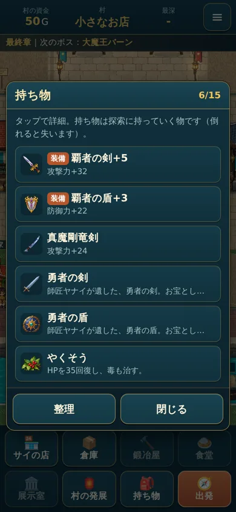
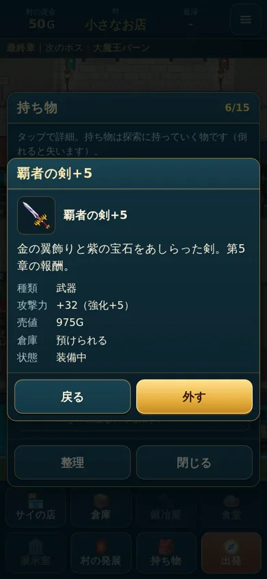
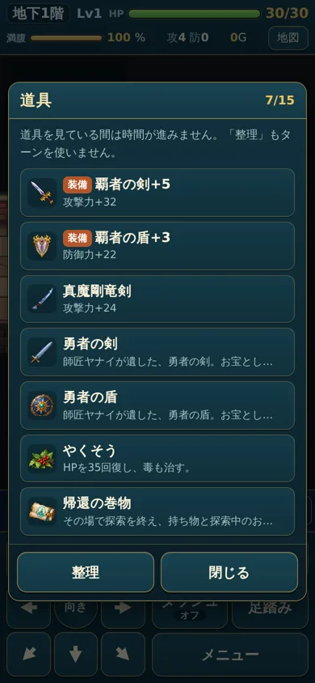

# 覇者の剣・覇者の盾と、お宝の勇者の剣・勇者の盾（2026年10月）

## 装備：覇者の剣・覇者の盾（名前と絵だけ変更）
| ID（変えていない） | 前の名前 | 今の名前 | 能力値 | 売値 | 入手 |
|---|---|---|---|---|---|
| `hero_sword` | 勇者の剣 | 覇者の剣 | 武器・攻撃+27 | 900G | 第5章のミストバーンを初めて倒したときの報酬 |
| `hero_shield` | 勇者の盾 | 覇者の盾 | 盾・防御+19 | 860G | 同上 |

- 能力値・売値・入手は、以前の報告と今のコードで同じでした。そのまま引き継いでいます。
- 強化は今までどおり、通常の鍛冶屋で強化できます。
- **IDを変えていない理由**
  - 前のセーブにある剣と盾（持ち物・装備中・倉庫）は、強化値も装備の状態もそのままで、覇者の剣・盾として読めます。
  - お宝に変える処理はしていません。
  - 報酬を受け取った記録（`rewardClaimed.mist`）もそのままなので、二重には配りません。
- **説明文:** 前は「師匠ヤナイが遺した、勇者の剣。」でした。今は見た目だけの説明です（「金の翼飾りと紫の宝石をあしらった剣（盾）。第5章の報酬。」）。
- **組み合わせ:** 覇者のセットは追加していません。真魔剛竜剣・竜の紋章・ドラゴニックオーラの盾のセットはそのままです。
  - 漆黒の盾＋大魔王のローブの攻撃低下を免れるのは、装備中の真魔剛竜剣だけのままです。

## 絵（ChatGPT 制作のドット絵）
- **原画:** `assets/reference/hasha-v1/hasha-sword-original.png`・`hasha-shield-original.png`（1254×1254、そのまま保持）。
- **ゲームで使う絵:** ほかのボスの報酬の装備と同じ寸法です。
  - 持ち物・装備・説明の画面：`assets/items-boss/hasha-sword.png`・`hasha-shield.png`（128×128）。
  - 床：`assets/items-boss/floor/`（64×64）。
- **作り方（`tools/make-hasha-icons.py`）:** 縮めただけで、描き直しや飾りの追加はしていません。
  - 縦横比はそのままで、正方形の中央に置いています（盾は 89×112 → 64では 44×56）。透明の背景も保っています。
  - 原画の縁の薄いにじみ（不透明度128未満）だけ透明にしました。
- **小さくしたときの見え方:** 128・64・持ち物の一覧（36ドット）で確かめました。
  - 金の翼飾り・紫の宝石・銀の刃と盾の面は、見分けられます（`docs/hasha-v1/icons-preview.png`）。
- **詳細イラスト版:** 今回は受け取っていないので、用途の分け方は無く、ドット絵だけです。

## お宝：勇者の剣・勇者の盾（別ID）
| ID | 名前 | 種類 |
|---|---|---|
| `hero_sword_relic` | 勇者の剣 | お宝（装備できない） |
| `hero_shield_relic` | 勇者の盾 | お宝（装備できない） |

- **絵:** 今までの勇者の剣・盾の絵（コードで描いた絵）をそのまま使います。
  - 今までの勇者の剣・盾には画像ファイルが無く、コードで描いていました。消したものはありません。
- **説明文:** 前の「師匠ヤナイが遺した、勇者の剣（盾）。」をお宝のほうへ移しました。
- **入手:** イベントで手に入る予定です。イベント・条件・売値・寄贈できるかは未決定なので、次のようにしています。
  - 今はどこからも出ません（床・敵・店・謎の旅商人・ボスの報酬に入れていません）。
  - 売れません（`noSell`）。展示室の枠にもありません。ティウの案内にも出ません。

## 確認
- **ロジック（`tests/logic.test.js`）**
  - IDと能力値・売値・報酬がそのままであること。
  - お宝が別IDで、どこからも出ないこと。
  - 前のセーブの剣+5（装備中）・盾+3（装備中）・倉庫の剣+8が、強化値と装備のまま覇者として読めること。
  - 攻撃力は 基本＋27＋5 であること。
  - 覇者のセットが無いこと。
- **ブラウザ（`tools/hasha-shots.js`、幅360・390・430）**
  - 持ち物で覇者の剣+5・覇者の盾+3が「装備」のまま出ること。説明の絵が128の絵であること。
  - ダンジョンの道具でも同じであること。
  - お宝の勇者の剣・盾は別の品として出ること（確認のために持たせた）。
  - 絵が縦横比を保つこと（contain）。

  
