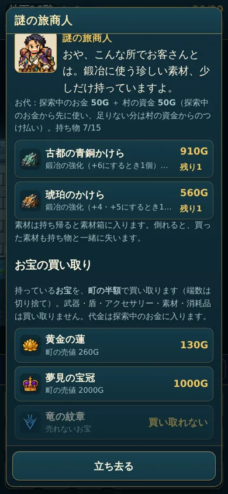
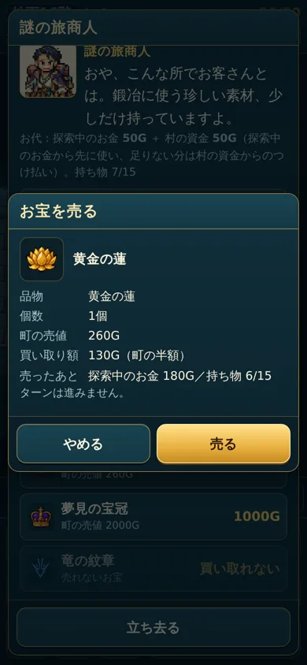
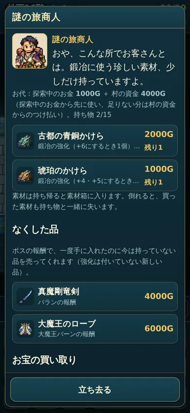
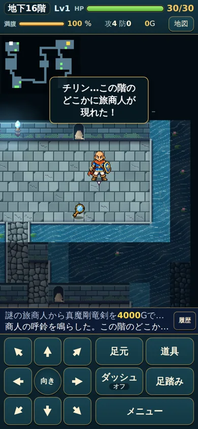
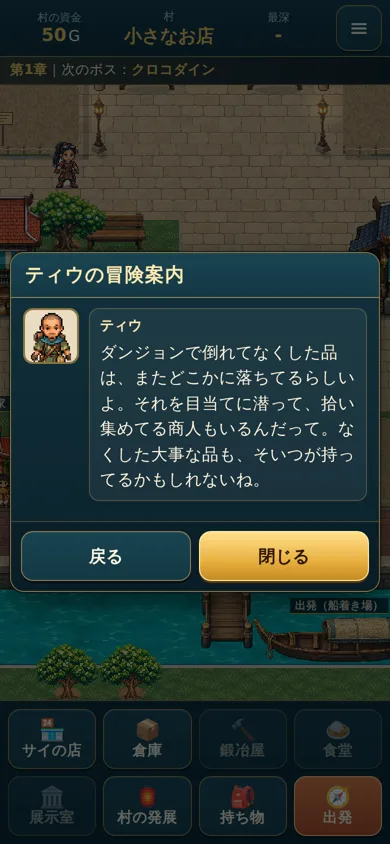

# 謎の旅商人のお宝の買い取り（2026年10月）

## ルール（`G.merchantBuysItem`・`G.merchantSellPrice`・`G.merchantSell`、`D.MERCHANT.buyRate = 0.5`）
- **買い取る品:** 分類が「お宝」（`type: 'treasure'`）で、町で売れる品だけです。名前や見た目では判定しません。
- **買い取らない品:** 武器・盾・アクセサリー・素材・消耗品（薬・食べ物・巻物・杖など）。
- **買い取り額:** 町の売値（`G.sellPrice`）の50%です。
  - 端数は切り捨てです。展示室のお礼（30%）や使い切った杖（1/3）と同じ `Math.floor` に合わせました。
  - 今あるお宝の売値はどれも偶数なので、端数は出ません。
- **代金:** 探索中のお金に入ります。倒れると、ほかの探索中のお金と同じように失います。
- **手順:** 1回に1個を売ります。確認画面で、品物・個数（1個）・買い取り額・売ったあとのお金と持ち物を見せます。連打しても1回だけです。ターンは進みません。
- **町の店:** 売却のルールは変えていません。

## 元々売れないお宝（今回も売れない。勝手に売れるようにしていない）
| ID | 名前 | 理由 |
|---|---|---|
| `hero_sword_relic` | 勇者の剣（お宝） | 売値・入手が未決定（`noSell`）。今はどこからも出ない |
| `hero_shield_relic` | 勇者の盾（お宝） | 同上 |

画面では「買い取れない」と出し、「売る」は押せません。

## 買い取り額の一覧
| お宝 | 町の売値 | 買い取り額 |
|---|---|---|
| アユタヤの古金貨 | 40G | 20G |
| ひすいの象 | 120G | 60G |
| 黄金の蓮 | 260G | 130G |
| 琥珀の首飾り | 300G | 150G |
| クロコダインの涙 | 350G | 175G |
| 古都の青銅鐘 | 420G | 210G |
| 水の都の王冠 | 560G | 280G |
| 大すいしょう | 700G | 350G |
| 氷炎結晶 | 900G | 450G |
| 七色の水晶花 | 950G | 475G |
| 黄金の象 | 1300G | 650G |
| 夢見の宝冠 | 2000G | 1000G |

## 確認
- **ロジック（`tests/logic.test.js`）**
  - 対象外の品（武器・盾・アクセサリー・素材・薬・食べ物・杖・売れないお宝3種・帰還の巻物）は売れず、お金も持ち物も変わらないこと。
  - お宝が半額で売れ、お金が増え、持ち物が減り、ターンが進まないこと。二重に売れないこと。
  - 端数の切り捨て、町の売値がそのままであること、保存・読み込み直しのあとも売ったままであること。
- **ブラウザ（`tools/merchant-sell-check.js`、幅360・390・430）:** 15項目すべて通りました。
- **今までのテスト:** ロジック164件、ブラウザ54件がすべて通りました。

 

---

# 素材の値段・なくした品の買い戻し・商人の呼鈴（2026年10月）

## 素材の値段（固定、ばらつきなし）
| 素材 | 値段 |
|---|---|
| 琥珀のかけら | 1,000G |
| 古都の青銅かけら | 2,000G |
| すいしょうのかけら | 3,000G |
| 神殿の金ぱく | 4,000G |

`D.MERCHANT.goods` の値段を変え、`priceSpread` を 0 にしました。

## なくしたボスの報酬の買い戻し（`G.buybackList`・`G.merchantBuyback`）
| 元のボス | 対象の品 | 1個の値段 |
|---|---|---|
| クロコダイン | クロコダインの斧・クロコダインの涙（お宝） | 1,000G |
| フレイザード | 氷炎の盾・氷炎結晶（お宝） | 2,000G |
| キルバーン | 漆黒の盾・ファントムマスク | 3,000G |
| 通常のバラン | 真魔剛竜剣（お宝の竜の紋章は2026年10月に廃止） | 4,000G |
| ミストバーン | 覇者の剣・覇者の盾 | 5,000G |
| 大魔王バーン | 大魔王のローブ | 6,000G |

- **対象:** 章の報酬の品（`D.CHAPTERS[c].reward.items`）です。値段は `D.MERCHANT.buyback` でボスごとに決めています。
- **対象外（指定が無いため）**
  - アクセサリーの竜の紋章（橋の向こうで拾う品）。
  - 竜魔神バランの報酬（まだ無い）。ドラゴニックオーラの盾。
  - 黄金の象（くり返し出る品）、素材、お宝の勇者の剣・盾。
- **売る条件:** 次の両方を満たす品だけです。
  1. 入手履歴（`village.bossObtained`）がある。
     - 記録するのは、ボスの報酬を拾ったときと、拾わずに帰って倉庫に届いたときです。
     - ボスを倒しただけで、まだ受け取っていない品は記録しません。
  2. 今は持っていない（`G.holdsItem`）。次のどこにも無いことを確かめます。
     - 村の持ち物（装備中を含む）・倉庫・探索中の持ち物・今の階の床（拾っていない報酬や、置いた品）。
     - 展示室（寄贈したお宝はなくした扱いにしません）。
     - ティウの交換予定は、持ち物・倉庫の品の番号を指すだけです。品は必ずどちらかにあります。
- **買うとき**
  - 買う直前に、もう一度確かめます。
  - 払い方は素材と同じです（探索中のお金から先に払い、足りない分は村の資金）。
  - お金が足りない・持ち物がいっぱいなら、何も変わりません。連打しても1つだけです。ターンは進みません。
  - 買ったあとは一覧から外れます。また失えば、また買えます。
- **強化値:** 買い戻した品は、強化の付いていない新しい品（+0）です。失った品の強化値は、今は記録していません。
- **前のセーブ:** 入手履歴が無いときは、読み込むときに一度だけ作ります。
  - 今持っている品・寄贈した品は、手に入れたことにします。
  - 第1〜5章は、章をクリアして村へ帰っていれば、その章の報酬を手に入れたことにします。報酬は拾ったか、倉庫に届いているからです。
  - 大魔王のローブは、大魔王バーンを倒していて、今の床に置いたままでなければ、手に入れたことにします。
- **どの商人か:** ふつうの旅商人と、呼鈴で呼んだ商人のどちらでも買い戻せます。

## 商人の呼鈴（`merchant_bell`・`G.summonMerchant`）
- **使い方:** 使い切りです。使うと、今の階のどこかに旅商人が現れます。
  - 取引の画面はすぐには開きません。探して、会いに行って取引します。
  - 呼べたときだけ1個減り、1ターン進みます。
- **置く場所**
  - たけから歩いて行ける部屋のマスです（8方向に歩けて、角は抜けません）。
  - たけから4マス以上離れた所です。
  - 階段・帰還の祠・帰還口・亀裂・道具・敵の上には置きません。モンスターハウスの部屋にも置きません。
- **呼べないとき（減らない・ターンも進まない）**
  - ボスの階で、ボスとの戦いが終わっていないとき。
  - もう商人がいるとき。
  - 置ける所が無いとき。
- **呼んだ商人:** ふつうの旅商人と同じです（その階の素材・お宝の買い取り・買い戻し）。
- **入手:** 街のイベントをコンプリートしたあと、こもれびの家（村の発展）に 1,000G 寄付するたびに1個もらえます。
  - 「街のイベントのコンプリート」の判定はまだ決まっていません（`D.BELL.unlock = null`）。それまで寄付の欄は出ません。
- **ほかの扱い:** 売れません（売値は未決定）。倉庫には預けられます。絵は仮で、コードで描いた金色の鐘です。

## ティウの「町のうわさ」
- 「なくした品のこと」を足しました（台詞はご指定のまま）。
- 倒れて失った品を床にもう一度置く仕組みは、追加していません。

## 確認
- **ロジック（`tests/logic.test.js`、169件すべて通過）**
  - 素材の値段。
  - 買い戻しの対象と値段。
  - 未入手・持ち物（装備中）・倉庫・床・展示室では出ないこと。
  - お金が足りない・持ち物がいっぱい・二度押しでも損や重複が無いこと。+0 であること。また失えば買えること。
  - 入手履歴の記録と、前のセーブの扱い。
  - 呼鈴：置き場所・歩いて行けること・減り方・ボス戦中・置けないとき・呼んだ商人の買い取り。
  - 寄付の判定と 1,000G。
- **ブラウザ（`tools/merchant-bell-check.js`、幅360・390・430、16項目）**
  - なくした品の一覧。
  - お金が足りないときに買えないこと。
  - 連打しても1本だけ買えること。
  - 呼鈴で商人が現れて、取引画面は開かないこと。
  - ティウのうわさ。
- **今までのテスト:** ブラウザ54件がすべて通りました。

  

## 商人の呼鈴の寄付の解放（2026年10月確定）
- 町の建設・改修をすべて終えると、こもれびの家（村の発展）で寄付できるようになります。
  - 対象は「村の発展」の一覧 `D.FACILITIES` の全項目です（施設8・飾り7の15項目）。
  - 一覧は別のチャットで見直し中なので、項目を足し引きすると、対象も自動で変わります。
- 隠しアイテムの発見・会話の閲覧・お宝の収集そのものは、条件に入れていません。
  - 建設に必要な寄贈などの条件は、各項目の解放条件のままです。
- 1,000Gを寄付するたびに、商人の呼鈴を1個もらえます。使い方・なくなり方・商人の出方は、以前のままです。

## 買い戻し（2026年10月確定）
- ボスの報酬のお宝（クロコダインの涙・氷炎の結晶）も、買い戻しの対象のままです。
- 一度手に入れて、今は持っていない品だけ売ります。展示室に寄贈した品は「なくした」扱いにしません。
- 値段は、もとのボスごとの値段（`D.MERCHANT.buyback`）です。

## ボスの戦利品と竜の紋章は売れない・竜の紋章の買い戻し（2026年10月）
- **売れない品（`noSell`）**：章のボスの報酬（クロコダインの斧・氷炎の盾・氷炎結晶・漆黒の盾・ファントムマスク・真魔剛竜剣・覇者の剣・覇者の盾・大魔王のローブ。クロコダインの涙は前から）、竜魔神バランの報酬（ドラゴニックオーラの盾は前から）、竜の紋章。
  - 町でも旅商人でも売れません。強化していても売れません。
  - 展示室に寄贈したときのお礼は、今までどおり品の売値の設定（`sell`）の30%です（氷炎結晶 270G）。
- **竜の紋章の買い戻し**：旅商人の「なくした品」に並びます（`D.MERCHANT.buybackItems`）。
  - 並ぶ条件：竜の紋章を一度手に入れている（村の橋の向こうで拾った、または竜魔神バランの報酬を拾った）、かつ今は持っていない（持ち物・装備中・倉庫・村のかばん・この階の床・展示室のどこにもない）。
  - 復活で使ってなくなっても、また買えます（何度でも）。
  - **値段 5,000G は仮**です（章の報酬の買い戻しは1,000〜6,000G）。払い方は素材と同じ（探索中のお金から先に、足りない分は村の資金）。
- テスト：`tests/logic.test.js`「ボスの戦利品と竜の紋章は売れない」「竜の紋章：なくしたら旅商人から買える」。
